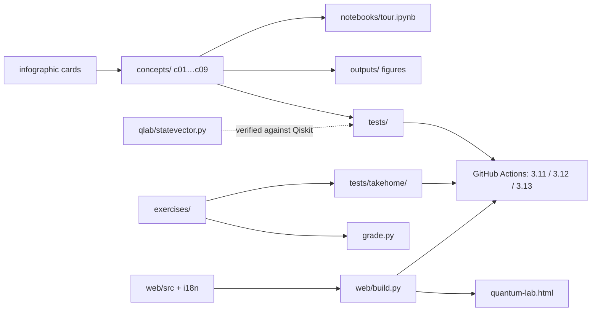

# Quantum Computing in 9 Concepts


Every concept from the "9 Quantum Computing Concepts Every Developer Should Know"
infographic, turned into working, tested code on **Qiskit 2.x**, with the
infographic's broken examples fixed and explained. Around it: an autograded
take-home for hiring, a nine-session curriculum for institutions, and an
interactive lab in eight languages that runs on a phone.

```
qubits → superposition → entanglement → gates → algorithms
       → circuits → hardware → error correction → advantage
```

| If you are… | Start here | Time |
|---|---|---|
| **A hiring manager or interviewer** | [`INTERVIEW_GUIDE.md`](INTERVIEW_GUIDE.md) — phone-screen bank, take-home, rubric | 10 min |
| **A candidate or learner** | `pip install -e .` then `python grade.py` — nine exercises, instant feedback | 2–4 h |
| **An instructor** | [`CURRICULUM.md`](CURRICULUM.md) — objectives, demos, labs, assessment per session | 15 min |
| **Reviewing the engineering** | the "Five-minute review" below | 5 min |
| **Just curious** | open `web/quantum-lab.html` in any browser (no install, works offline) | 2 min |

## Quick start

```bash
python -m venv .venv && source .venv/bin/activate      # Windows: .venv\Scripts\activate
pip install -e ".[dev]"
qlab run                   # all 9 concepts, ~1 minute, figures in outputs/
qlab test                  # 110 project tests, ~15 s
qlab grade                 # the take-home scorecard (0/9 until you implement exercises/)
```

No account anywhere: hardware effects come from a stored calibration snapshot of a
156-qubit IBM Heron chip. To submit to a real device: `python -m concepts.c07_hardware --real`.

Prefer containers? `docker build -t quantum-computing-9 . && docker run --rm quantum-computing-9`.
Prefer notebooks? `notebooks/tour.ipynb` is pre-executed with every figure inline.

## Five-minute review (for engineers and hiring managers)

1. **Run the infographic's own code and watch it fail:** `pytest tests/test_infographic_claims.py -v`.
   Cards 1–6 import APIs removed in 2024; card 4 claims all-1s but gives 50/50; card 5's Grover
   returns `00`; card 8's "error correction" returns the error. [`CORRECTIONS.md`](CORRECTIONS.md) has the evidence.
2. **Read one module end to end:** `concepts/c08_error_correction.py` (180 lines). Ancillas, syndrome
   measurement, `if_test` correction, the phase-error blind spot, and threshold curves, each asserted in `tests/test_concepts.py`.
3. **Check the simulator against Qiskit:** `tests/test_statevector.py` runs 25 random circuits through
   `qlab/statevector.py` (100 lines of NumPy) and Qiskit and demands identical amplitudes.
4. **See how the grader protects itself:** CI runs the exercise tests twice, once against `exercises/solutions/`
   (must pass) and once against the stubs (must fail), so a leaked solution breaks the build.
5. **Look at the i18n contract:** `python web/build.py --check` fails if any of the 8 language files is missing
   a key, drops a `{placeholder}`, or changes an inline tag relative to `en.json`.

## What each module demonstrates

| # | Module | What you'll see | Beyond the infographic |
|---|---|---|---|
| 1 | `c01_qubits` | Amplitudes, Born rule, Bloch vectors, measurement collapse | Same experiment on a **from-scratch NumPy simulator**; the Holevo bound |
| 2 | `c02_superposition` | H\|0⟩ is 50/50, but H·H\|0⟩ is **always 0** | Quantum vs classical coin; \|+⟩ vs \|−⟩; why "tries all answers at once" is a myth |
| 3 | `c03_entanglement` | All four Bell states, GHZ-5 | **CHSH Bell test (S ≈ 2.83 > 2)**, no-signaling proof, **teleportation** with feed-forward |
| 4 | `c04_gates` | Matrices, unitarity, CNOT truth table, Rx sweep | Gate identities (HXH = Z, T² = S…); card-4 bug explained |
| 5 | `c05_algorithms` | **Deutsch–Jozsa**, **Grover** (2-qubit fixed + n-qubit), **QFT period finding**, **VQE** | Grover overshoot curve; why QFT is the heart of Shor |
| 6 | `c06_circuits` | Gate-by-gate state evolution, depth/size, **OpenQASM 3** export | Compiling for real wiring: same state, 4 vs 13 two-qubit gates |
| 7 | `c07_hardware` | Real chip vitals (T1, T2, gate/readout errors), ideal vs noisy GHZ | **Measure T1 and T2 yourself** and fit them; corrected hardware landscape |
| 8 | `c08_error_correction` | **Working 3-qubit bit-flip code** (ancillas, syndrome, conditional correction) | Phase-flip code; why bit-flip codes miss Z errors; threshold curves d = 1…7 |
| 9 | `c09_advantage` | Memory wall (2ⁿ amplitudes), measured simulation time vs qubits | **Cross-entropy benchmarking** behind Google's 2019 claim; timeline to 2026 |

## The take-home (exercises/)

Nine exercises, one per concept, ★ to ★★★, 20–90 minutes each. Stubs in `exercises/`,
reference solutions in `exercises/solutions/`, autograder in `tests/takehome/`.

```bash
python grade.py              # your score, per exercise, with the failing tests named
python grade.py --solutions  # 9/9 against the reference implementations
```

```
  5. Grover from scratch            ★★★  ████████████████████ 14/14
  6. Circuits, depth, wiring        ★★   ████████████████████ 12/12
```

Grover from scratch is checked as a matrix (the oracle must be exactly a phase flip on
the marked state), so there is no shortcut through `initialize`. `INTERVIEW_GUIDE.md`
maps each exercise to the skill it probes and gives a code-reading rubric.

## The Quantum Lab (web/)

One self-contained HTML file: nine interactive panels on a JavaScript statevector
simulator that reproduces the Python results (CHSH 2.828, Grover, GHZ, T1/T2…).
Light and dark themes, keyboard and screen-reader accessible, works from `file://`.

Languages: English, Español, Português (Brasil), Français, Deutsch, हिन्दी, 中文, 日本語.
The UI strings are JSON files in `web/i18n/`; a native speaker can add a language in an
afternoon ([`CONTRIBUTING.md`](CONTRIBUTING.md)). `web/build.py` inlines them into the page.

## Project layout

```
quantum-computing-9/
├── concepts/              one runnable module per concept (c01 … c09)
├── qlab/                  statevector.py (NumPy simulator), backend.py (run helpers, Heron noise), cli.py
├── exercises/             take-home stubs  ·  exercises/solutions/  reference implementations
├── tests/                 project tests  ·  tests/takehome/  the autograder
├── web/                   src/template.html + i18n/*.json  →  build.py  →  quantum-lab.html
├── notebooks/             tour.ipynb (executed) + make_tour.py
├── outputs/               figures + summary.md written by run_all.py
├── run_all.py · grade.py · Dockerfile · pyproject.toml
├── CORRECTIONS.md         what the infographic gets wrong, with the fixes
├── INTERVIEW_GUIDE.md     screening questions, take-home logistics, rubric
├── CURRICULUM.md          nine-session course plan for any institution
└── CONTRIBUTING.md        languages, exercises, modules
```



## Engineering choices

- **Every claim is a test.** "Grover finds the marked item", "any single bit flip is corrected",
  "CHSH exceeds 2": all asserted. 110 project tests + 89 autograder tests.
- **Run what you wrote.** Circuits execute at `optimization_level=0` unless compilation is the
  point, so the transpiler cannot quietly cancel the gates a demo is about.
- **Reproducible.** Fixed seeds: the same command prints the same numbers every time, on every OS.
- **Modern APIs only.** `AerSimulator.run`, `Statevector`, `if_test` dynamic circuits, `QFTGate`,
  the client-side IBM `Sampler`. Nothing removed or deprecated.
- **Lint-clean.** `ruff check` and `ruff format --check` gate CI; config in `pyproject.toml`.
- **Offline by design.** No cloud account, no server, one HTML file for the lab. Built for classrooms
  with limited bandwidth as much as for laptops with plenty.

## Where to go next

- Swap the bit-flip code for Shor's 9-qubit code (nest `c08`'s two codes).
- Factor 15 with Shor: replace `period_finding`'s prepared state with modular exponentiation.
- Run `c09`'s XEB experiment on real hardware with `--real` and compare to the noise model.
- Add your language to the lab, or a tenth concept (BB84 is a natural one).

## Licence

MIT. If you use this in a course or a hiring process, a link back helps others find it.
